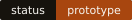
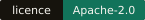
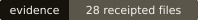

<div align="center">

<picture>
  <source media="(prefers-color-scheme: dark)" srcset="docs/assets/gqodb-logo-cream.svg">
  
</picture>

# Checkable in an afternoon

**The GQODB open layer** · lossless market-data codecs, formats and their evidence






[Install](#build-it) · [Formats](#formats) · [Benchmarks](#benchmarks) ·
[Evidence](#evidence) · [Crates](#crates) · [Licence](#licence-and-the-engine)

</div>

---

GQODB is built to store market data the way research actually needs it: every record
keeps the bytes as they arrived, the moment they arrived, and the evidence for the clock
that measured it. This repository is the part of GQODB worth giving away — **the codec**:
the exact types, the lossless tick and order-book compression, the indexed segment
files, the format facade that reads them, and the benchmark protocols and evidence
behind the numbers below.

A codec is checkable in an afternoon, it is the part these benchmarks actually
measure, and every file it writes is a plain `.gqodb` file you can inspect without us.

> [!IMPORTANT]
> **A prototype, released as source: 0.1.0 preview.** There is no crates.io release,
> no signed artifact and no format-stability promise yet: APIs, command-line tools and
> file formats may change in any 0.x release (see [API stability](docs/API_STABILITY.md)
> for what is and is not promised). The tests pass on Linux and macOS in CI; Windows is
> not supported yet (one test fails there, see "Still not measured"). The GQODB engine — raw journal,
> ledger and receipts, recovery, quality, features, causal query, ops and
> connectors — is **not** in this repository and is not licensed by it.

<table>
<tr>
<td width="33%" valign="top">

#### Exact or it fails

A price is an integer plus its scale. A round trip restores every value, null,
timestamp and float bit exactly — or it returns an error. Tested on the fixtures and
column types in the suites and by 15 fuzz targets; not proven for every schema. Nothing
is rounded to fit a block, and a corrupt frame is refused rather than repaired.

`Functionally tested` — round trips, corrupt frames, truncated tails

</td>
<td width="33%" valign="top">

#### The header decides

Tick and order-book segments share `GQOBHDR1` framing, and the header — not the file
extension — selects the codec profile. Renaming a `.tick` file to `.ob` changes
neither its contents nor how it is read.

`Functionally tested` — profile selection from the header

</td>
<td width="33%" valign="top">

#### Receipts where they exist

Each figure names its run, its dataset and its boundary — including the runs where
Parquet wins. Twenty-eight result files are pinned by build receipts; one script checks
every receipt and recomputes the B11, B15 and B17 summaries (B06 in part) from the stored
results. B06 and B12 have no receipts and are marked as historical.

`Hash checked` — 28 of 28 receipted files verify

</td>
</tr>
</table>

## What is here, and what is not

| In this repository — Apache-2.0 | Not in this repository |
| --- | --- |
| `gqodb-types` — exact event and time types with explicit scales | The raw journal, ledger and durable receipts |
| `gqodb-blocks` — lossless codec kernels, tick and book profiles | Recovery of a live writer, quality checks and features |
| `gqodb-store` — indexed `.gqodb.ob` segments with range reads and prefix recovery | Causal as-of queries, ops and health assessment |
| `gqodb-codec` — the native format facade and file inspection | Venue connectors and the same-host shared-memory bus |
| `gqodb-lang` — the command language: parser, diagnostics and planner | Running `as of`, provenance and joins (the language reserves the words) |
| `gqodb-cli` — the `gqodb` command, which runs the language over native files | |
| Format notes, benchmark protocols, result files, receipts and a verifier | The GCO quant suite: backtest, paper execution, risk, models, experiments |

## Where it stands today

<div align="center">

| 4 | 76 | 28 | 1 |
|:---:|:---:|:---:|:---:|
| crates | tests passed, 0 failed, 0 ignored | receipted result files | published release (0.1.0 preview) |

<sub>Rust 1.96.0 · Linux x86_64 · 18 October 2026 · plus 7 doc-tests · default build and `zstd-input` build both green</sub>

</div>

> [!NOTE]
> Read the numbers like an engineer, not a brochure. Benchmark figures are observations
> from named runs on one host, mostly with warm caches (B17 also reports reads after
> the files were evicted from the page cache). The raw inputs are not redistributed:
> you can check the receipted result files against their receipts and recompute the
> B11, B15 and B17 figures from the stored results, but re-running B11–B15 from scratch
> needs a Bybit capture of your own.

## Build it

To build, test and install the open command-line tools from a clean checkout:

```sh
./install.sh --prefix "$HOME/.local"
```

On Debian/Ubuntu, the installer detects missing Git, curl, certificates and build
tools and asks before installing the needed packages with `apt-get` and sudo.
If Rust 1.96.0 is missing, a separate `[y/N]` question offers to install it with
Rustup for your user. An existing matching active Rust toolchain is reused.
Answering `n`, pressing Enter or reaching end-of-input stops that installation;
`--force` only controls replacing GQODB binaries and does not approve prerequisites.
Other Linux distributions need their system packages installed manually first.
It installs `gqodb-codec`, `ob_store` and `gqodb`, their licence files and a build receipt.
Existing binaries are refused unless `--force` is supplied. Use `--ref COMMIT`
to select an exact source revision; `./install.sh --help` lists the options.
This is a source installer, not a signed binary release.

The installer tests the release profile and reuses its optimized dependencies
when building the installed tools. Cargo compiles dependencies in parallel;
its default job count follows the available logical CPUs. Set `CARGO_BUILD_JOBS`
to override that limit. CI retains the separate debug-profile checks.

Without an existing checkout, first download the script (using curl or a browser),
then run it so the confirmation questions can read your answers:

```sh
curl -fsSLo install-gqodb.sh https://raw.githubusercontent.com/GerritsenQuantOffices/GQODB/main/install.sh
sh install-gqodb.sh
```

For a manual build and direct file checks:

```sh
cargo build --workspace --bins --release --locked
cargo test  --workspace --all-targets --locked

# write, inspect and validate a native file; the extension is never trusted
target/release/gqodb-codec demo book-segment /tmp/demo.gqodb.ob
target/release/gqodb-codec inspect  /tmp/demo.gqodb.ob       # codec_profile: gqodb-book-runs-planes-lz4
target/release/gqodb-codec validate /tmp/demo.gqodb.ob orderbook
cp /tmp/demo.gqodb.ob /tmp/renamed.gqodb.tick
target/release/gqodb-codec inspect  /tmp/renamed.gqodb.tick  # still the book profile

# order-book segments: verify, recover the complete prefix into a new file, range query
target/release/ob_store verify  /tmp/demo.gqodb.ob                  # verified 1 blocks, 3 rows
target/release/ob_store recover /tmp/demo.gqodb.ob /tmp/recovered.gqodb.ob
target/release/ob_store query   /tmp/demo.gqodb.ob SYNTH 10 12      # 3 rows

# check every receipt and recompute the B11, B15 and B17 summaries
python3 results/verify_public_evidence.py
python3 benchmarks/verify_manifest.py
```

> [!WARNING]
> `ob_store verify`, `ob_store query` and `ob_store recover`, and the library calls behind
> them (`Reader::read_all`, `visit_blocks`, `read_block`, `query`, `recover`), run on the
> unchecked decoding layer, which is not audited. A finding in it, made by reading the code and not by a fuzzer, is fixed: a crafted
> block could make it request a very large allocation (62.9 GB from a 60 KB block); it now
> refuses blocks whose decoded strings exceed 128 MiB. That closes one class, not all: for
> example a 16 KB block can still decode there to about 0.5 GiB of integer columns. Use these
> commands on files you wrote yourself. For files from elsewhere use `gqodb-codec inspect` or
> `validate`, or `Reader::read_block_bounded`; see [docs/FUZZING.md](docs/FUZZING.md).

The `demo` and `recover` commands only create new files: if a target already exists
they stop with `File exists`, so remove the files under `/tmp` (or use other names)
before running the block again. The commands above were run in a clean checkout of this
release branch on 2026-10-18 (Linux x86_64, Rust 1.96.0) and produced the output shown in
their comments.

Requirements for a manual build: Git, a C linker (`cc`), Rust and, for the two
verification scripts, Python 3 (standard library only). The tested toolchain is Rust
1.96.0 on Linux x86_64. The declared minimum, Rust 1.85, was built and tested on Linux
on 2026-10-18 with the committed `Cargo.lock` and has a CI job; newer dependency
versions are not covered. The tests also pass on macOS (GitHub Actions on 2026-10-18, and locally on Apple silicon with Rust 1.98.1);
the Windows CI entry fails, see "Still not measured". The default build is pure Rust. The original B06
trade samples were zstd-compressed Parquet; to read inputs like that, build
`gqodb-blocks` with `--features zstd-input`, which adds the native zstd library from
crates.io. It only decodes inputs and is never one of the measured codecs.

## Query the files

The `gqodb` command asks `.gqodb.tick` and `.gqodb.ob` files what they hold, with a small command
language (`gqodb-lang`, run by `gqodb-cli`). The two commands below were run with binaries built from this
repository on 2026-10-18 (Linux x86_64, Rust 1.96.0) on the demo files of `gqodb-codec`, three synthetic rows
stamped a few nanoseconds after 1970-01-01, and printed what is shown:

```sh
d=$(mktemp -d)
target/release/gqodb-codec demo tick-segment "$d/demo.gqodb.tick"
target/release/gqodb-codec demo book-segment "$d/demo.gqodb.ob"

target/release/gqodb --format table "show trades SYNTH 1..3 on sequence in $d | columns sequence, price, quantity"
# sequence  price  quantity
# --------  -----  --------
# 1         1.00   2
# 2         1.00   2
# -- clock sequence, range [1, 3)
# -- files: 1 read, 1 skipped · blocks: 1 read of 1 in the files read · bytes: 2455 · rows: 3 scanned, 2 out
# -- skipped demo.gqodb.ob: other stream

target/release/gqodb --format table "show trades SYNTH 1970-01-01.. on source in $d | columns sequence, source_utc_ns"
# sequence  source_utc_ns
# --------  ------------------------------
# 1         1970-01-01T00:00:00.000000008Z
# 3         1970-01-01T00:00:00.000000010Z
# -- clock source, range [1970-01-01T00:00:00.000000000Z, ..)
# -- files: 1 read, 1 skipped · blocks: 1 read of 1 in the files read · bytes: 2455 · rows: 3 scanned, 2 out
# -- skipped demo.gqodb.ob: other stream
# -- excluded: 1 row without a source value
```

A range always names its clock; there is no default. A row that is empty on the chosen clock (the
second row has no source time) is outside every range on it, and the footer counts it. Prices are written
exactly from their integer and scale, results are cut at 1,000 rows unless you ask for more, and every
cut is reported. The full reference, with the grammar, budgets, error codes and exit codes, is
[docs/LANGUAGE.md](docs/LANGUAGE.md); that page also lists the flaws that are known today.

The language is a 0.x preview with no stability promise: the grammar, the error texts and the output
may change in any 0.x release (see [API stability](docs/API_STABILITY.md)). `as of`, provenance, quality
and joins are words the language reserves for the GQODB engine, which is not in this repository; the
open executor refuses them with the error `E-ENGINE`. The command only reads files: it writes none
except a new result file when you pass `--out`.

## Formats

| Format | Holds | Detected by |
| --- | --- | --- |
| `.gqodb.tick` | Native tick and trade segments with the adaptive tick profile | `GQOBHDR1` header, tick profile |
| `.gqodb.ob` | Native order-book segments with block index, range read and committed-prefix recovery | `GQOBHDR1` header, book profile |
| Arrow / Parquet | Exchange and benchmark reference, with exact scales and UTC nanoseconds | — |

Frames carry CRC checks; a physically incomplete tail is distinguished from a corrupt
frame, and recovery writes a new file instead of editing the old one. Nanosecond units
do not imply nanosecond accuracy. See the [block format](docs/B02_FORMAT.md), the
[block protocol](docs/BLOCK_PROTOCOL.md), the [tick profile](crates/gqodb-codec/src/tick/README.md)
and the [order-book profile](crates/gqodb-codec/src/orderbook/README.md).

## Benchmarks

The [benchmark inventory](benchmarks/README.md) and machine-readable
[manifest](benchmarks/manifest.json) map every cited run to tracked runner source,
protocols and stored evidence. CI fails if any declared benchmark file or any file
under `results/` exists outside Git.

Historical runs on fixed datasets and configurations, one host; B06 to B15 are warm-cache
runs and B17 also reports page-cache-evicted reads. `results/verify_public_evidence.py`
checks every receipted file against its receipt and recomputes the B11, B15 and B17
summaries from the stored results (B06 in part). It does not recompute the B12 and B13
figures (for example the B13 "2.4–3.5×" below).

The [benchmark inventory](benchmarks/README.md) maps each run to its runner,
protocol and input requirements. Use `./benchmarks/run.sh verify` to check the
published evidence, or `./benchmarks/run.sh synthetic-smoke` from a clean committed
checkout for a small synthetic check. Neither command downloads market data.

### Trades — reproducible file-level result on public data (B17)

> [`results/b17-public-trades-20261018`](results/b17-public-trades-20261018/ASSESSMENT.md) (run 2, the
> main result, measured on commit `c07fbde`, the code that is released) —
> Binance aggregate trades of PAXGUSDT (spot, 2025-10 and 2026-02), the first 1,048,576 rows of each
> month (D1, D2; 32 blocks of 32,768 rows) and both full months (3.1 and 3.7 million rows). Real files
> written durably (all files and directories fsynced), read fully and by a 60-second time window, single
> thread, one pinned core, fresh process per sample, up to 15 unflagged measured rounds after 3 warm-ups,
> candidates alternated round by round, medians with a block-bootstrap 95% interval.
> Protocol pre-registered and hash-pinned ([protocol](docs/B17_PUBLIC_TRADES_PROTOCOL.md); the
> [addenda](docs/B17_PUBLIC_TRADES_ADDENDA.md) record every deviation, including A-004, an amendment of
> the interference thresholds and the repeat budget made after a first start of run 1 was aborted); every sample
> is stored and the figures are recomputed from them by `results/verify_public_evidence.py`. Warm page
> cache in the table (page-cache-evicted reads are in the assessment), one host, shared with unrelated jobs.

**Two runs, and why.** The matrix was measured twice with the same protocol and settings. Run 1
(`results/b17-public-trades-20261017`) was measured before the limit on decoded string bytes was added to the
reader; run 2 was measured on the exact commit that is released, so that every number applies to the tagged code.
Run 2 is the main result; run 1 is kept for comparison and is not hidden. They differ little (below).

**Things to know before reading the table.** First, "15 unflagged measured rounds" rests on A-004: applied to
the stored samples, the registered thresholds would have left every cell of run 2 below 15 valid rounds. Second, two
cells of run 2 are UNDERPOWERED even under A-004: D2/v1 (11 valid rounds) and D2/v2 (12), because unrelated jobs
on the shared host kept landing on the benchmark core's hyperthread sibling; the D2 rows below therefore rest on 11 rounds
(run 1 had 15 there, with matching ratios). Over all measured rounds, flagged ones included, 22 of the 864 verdicts of run 2 change, one of them on a
headline cell (D2 warm range read against `clickhouse-default`, better to inconclusive). Third, after the limit fix `decode` makes one extra pass over each string
column and `encode` one comparison per string row. Every operation-time median of run 2 is 0.4% to 7% lower than in run 1
for GQODB, and the Parquet and DuckDB baselines moved the same way (the machine state differed), so absolute medians cannot show
the effect. Corrected against the Rust Parquet candidates measured in the same rounds, GQODB full reads are about 0.5% to
1.5% slower in run 2 than in run 1 (cold reads: 24 of 24 candidate-and-cell pairs above 1, median +1.3%; warm reads:
median +0.7%), which fits the extra pass; no verdict changes. The sentence in run 2's assessment that the effect is not
visible is superseded by this drift-corrected comparison (addendum A-005; the assessment is sealed and was not edited).
Fourth, the receipt of run 2 names `c07fbde`, which is in this history; run 1's receipt names a commit that is not
(addendum A-005).

Baselines: four Parquet configurations written by the same Rust library, DuckDB 1.5.6 (native file and three
Parquet writers) and ClickHouse 26.3 LTS (MergeTree, default and one pre-registered codec chain); every read
returned the reference table bit for bit. Ratio is GQODB / strongest baseline on that axis (below 1 is better for
GQODB); the verdict uses a 2% band for bytes, 5% for time and 10% for memory.

| Slice | Axis | GQODB | Strongest baseline | Ratio [95% interval] | Verdict |
| --- | --- | ---: | --- | ---: | --- |
| D1 | Stored bytes | 6.51 MB | `duckdb-parquet-zstd`, 6.70 MB | 0.972 | better |
| D1 | Durable write | 225.2 ms | `parquet-delta-bss-snappy`, 253.6 ms | 0.888 [0.88, 0.91] | better |
| D1 | Full read, warm | 65.5 ms | `parquet-delta-bss-lz4`, 81.2 ms | 0.806 [0.79, 0.83] | better |
| D1 | 60 s range read, warm | 3.2 ms | `parquet-delta-bss-lz4`, 4.1 ms | 0.772 [0.76, 0.79] | better |
| D1 | Peak memory, write | 72.6 MiB | `duckdb-parquet-matched`, 17.1 MiB | 4.244 [4.12, 4.30] | **worse** |
| D1 | Peak memory, full read | 68.1 MiB | `parquet-delta-bss-snappy`, 68.8 MiB | 0.990 [0.99, 0.99] | equivalent |
| D2 (n = 11, underpowered) | Stored bytes | 6.21 MB | `duckdb-parquet-zstd`, 7.63 MB | 0.814 | better |
| D2 (n = 11, underpowered) | Durable write | 228.5 ms | `parquet-delta-bss-snappy`, 250.0 ms | 0.914 [0.90, 0.92] | better |
| D2 (n = 11, underpowered) | Full read, warm | 66.5 ms | `parquet-delta-bss-lz4`, 77.8 ms | 0.855 [0.85, 0.87] | better |
| D2 (n = 11, underpowered) | 60 s range read, warm | 3.2 ms | `parquet-delta-bss-snappy`, 4.1 ms | 0.786 [0.78, 0.79] | better |
| D2 (n = 11, underpowered) | Peak memory, write | 72.5 MiB | `duckdb-parquet-matched`, 17.4 MiB | 4.175 [4.15, 4.21] | **worse** |
| D2 (n = 11, underpowered) | Peak memory, full read | 68.1 MiB | `parquet-delta-bss-snappy`, 68.8 MiB | 0.991 [0.99, 0.99] | equivalent |

**GQODB does not win every axis, and the earlier headline "wins every axis" is withdrawn.** On this input it is the
smallest layout and, with the exceptions below, the fastest on write, full read and the time-window read, but:
the peak memory of the write is 2.2 to 4.3 times that of the DuckDB Parquet writers on the two slices (4.24 and 4.18 against
the matched LZ4 writer in the table) and 4.5 to 5.0 times that of the DuckDB default Parquet writer on the full months (1.6 to
2.1 times DuckDB native). That loss most likely belongs to the measured adapter path and not to the GQODB format: the Rust
adapter reads the whole source table into memory before writing, for every Rust candidate including the Rust Parquet
writers (which therefore sit at the same level), while DuckDB streams its input. This is an inference from that
comparison; a streaming write path for GQODB has not been built or measured, so how the writer behaves on much larger
inputs is open. Further: full-read memory on the full months
is 2.5 to 3.0 times that of the ClickHouse engine process (not measured like for like); the warm range read against
ClickHouse is inconclusive in 7 of 16 cells, none worse, with point estimates from 0.33 to 1.24 (1.24 for S2/v1 against `clickhouse-default` is
no win; the window holds only 45 and 468 rows, and the ClickHouse operation time is wall time minus process start-up floored
at zero: 141 of its 932 range-read samples record 0, so these ratios are noise in both directions); in V2
(prices as scaled integers) the write-time advantage over the delta/BSS LZ4 and Snappy Parquet writers shrinks to equivalent or slightly worse
(about 1.0 to 1.06; 1.06 against `parquet-delta-bss-snappy` on D1, worse; against the dictionary-LZ4 and Brotli writers it stays at 0.25 to 0.46), and the CPU time of the write is worse than `parquet-delta-bss-snappy` on D1 in
V2 (1.07). The margins against the strongest Parquet configuration (V1) are 9 to 25% in time, not factors; against ClickHouse, whose range reads
are noisy, see the point estimates above. The large
factors in the full assessment are mostly against baselines in their default settings (for example ClickHouse default is
3.6 to 3.9 times larger) and, for ClickHouse full reads (0.23 to 0.29), against its process model: one process per
statement, the result handed to the client as Arrow IPC through a pipe. The end-to-end columns are not comparable for
reads (they include digest code that differs per adapter); on the full months the end-to-end warm full read is worse than
DuckDB (1.10 to 1.27) while the operation time is better. Every cell, loss and caveat is in the
[assessment](results/b17-public-trades-20261018/ASSESSMENT.md).

**Run 1 against run 2** (headline slices, V1; ratio GQODB / strongest baseline of that run, same axes and bands). Run 1's
assessment is [here](results/b17-public-trades-20261017/ASSESSMENT.md). The label "n = 11" on the D2 rows refers to run 2; run 1 had 15 valid rounds there.

| Slice | Axis | Run 1 ratio | Run 2 ratio | Run 1 verdict | Run 2 verdict |
| --- | --- | --- | --- | --- | --- |
| D1 | Stored bytes | 0.972 (`duckdb-parquet-zstd`) | 0.972 (`duckdb-parquet-zstd`) | better | better |
| D1 | Durable write | 0.898 (`parquet-delta-bss-snappy`) | 0.888 (`parquet-delta-bss-snappy`) | better | better |
| D1 | Full read, warm | 0.821 (`parquet-delta-bss-lz4`) | 0.806 (`parquet-delta-bss-lz4`) | better | better |
| D1 | 60 s range read, warm | 0.791 (`parquet-delta-bss-lz4`) | 0.772 (`parquet-delta-bss-lz4`) | better | better |
| D1 | Peak memory, write | 4.261 (`duckdb-parquet-matched`) | 4.244 (`duckdb-parquet-matched`) | worse | worse |
| D1 | Peak memory, full read | 0.990 (`parquet-delta-bss-snappy`) | 0.990 (`parquet-delta-bss-snappy`) | equivalent | equivalent |
| D2 (n = 11, underpowered) | Stored bytes | 0.814 (`duckdb-parquet-zstd`) | 0.814 (`duckdb-parquet-zstd`) | better | better |
| D2 (n = 11, underpowered) | Durable write | 0.905 (`parquet-delta-bss-snappy`) | 0.914 (`parquet-delta-bss-snappy`) | better | better |
| D2 (n = 11, underpowered) | Full read, warm | 0.843 (`parquet-delta-bss-lz4`) | 0.855 (`parquet-delta-bss-lz4`) | better | better |
| D2 (n = 11, underpowered) | 60 s range read, warm | 0.798 (`parquet-delta-bss-lz4`) | 0.786 (`parquet-delta-bss-snappy`) | better | better |
| D2 (n = 11, underpowered) | Peak memory, write | 4.203 (`duckdb-parquet-matched`) | 4.175 (`duckdb-parquet-matched`) | worse | worse |
| D2 (n = 11, underpowered) | Peak memory, full read | 0.989 (`parquet-delta-bss-snappy`) | 0.991 (`parquet-delta-bss-snappy`) | equivalent | equivalent |

Across all 864 comparisons of the eight cells (GQODB against each baseline on each axis, including secondary axes),
26 verdicts differ between the runs: 15 are range reads against ClickHouse (3 to 7 ms, noisy), and the rest sit
on band edges (end-to-end and CPU axes, V2 writes, cold reads). On the headline axes of the two V1 slices against every
headline candidate, exactly two verdicts changed: the warm range read against `clickhouse-default` on D1 (better in
run 1, inconclusive in run 2) and against `clickhouse-tuned` on D2 (inconclusive in run 1, better in run 2). One V2 cell moved
in the unfavourable direction: D1 write including normalisation against `parquet-delta-bss-snappy`, inconclusive in run 1 and
worse in run 2. Counts of verdicts over the 864 comparisons, run 1 / run 2: better 711 / 711, equivalent 94 / 98,
inconclusive 20 / 15, worse 39 / 40.

**Input data: Binance Vision ([data.binance.vision](https://data.binance.vision)).** The data are provided by Binance
under CC BY-NC-SA 4.0 and the Binance Vision Dataset Terms (version 1.0, last updated 26 August 2026). This repository
contains none of them; its result files are aggregates only (the frozen protocol and one synthetic fixture do quote a
handful of per-trade values, and whether the aggregates fall under the share-alike clause is an open point: see the
[licence notes](docs/BASELINE_LICENCES.md)). Fetch the data yourself (`./benchmarks/run.sh public-trades fetch`)
and comply with those terms. Binance does not sponsor or endorse this project or these results.

Rerun it: `./benchmarks/run.sh public-trades` (needs DuckDB and ClickHouse from
`benchmarks/baselines/install_tools.py`; the timed matrix takes a few hours). In the CI job the B17 digest and end-to-end tests
are skipped when `pyarrow` and `duckdb` are not installed, which is how that job runs (installing them there was left out on purpose);
the offline fixtures, the Rust adapter tests and the evidence verifier still run.

<details>
<summary><b>B06: the earlier in-memory codec comparison (historical, no receipts)</b></summary>

> `results/b06` — 1,048,576 aggregate trades per sample (32 blocks), **in-memory codec
> passes only**, one warm-up and nine measured passes per mode, medians. GQODB is compared per
> axis against the **strongest** of five Parquet configurations on that axis. The input files no longer
> exist and cannot be redistributed, so this run cannot be repeated; it is superseded by B17 above.

| Sample | Axis | GQODB | Strongest Parquet | Difference |
| --- | --- | ---: | --- | ---: |
| ETH | size | **5.089 MB** | normalized-LZ4, 5.464 MB | **−6.9%** |
| ETH | encode | **78.363 ms** | delta/BSS-Snappy, 146.439 ms | **−46.5%** |
| ETH | decode | **23.666 ms** | normalized-LZ4, 38.719 ms | **−38.9%** |
| UNI | size | **4.708 MB** | normalized-LZ4, 6.189 MB | **−23.9%** |
| UNI | encode | **65.478 ms** | delta/BSS-LZ4, 142.945 ms | **−54.2%** |
| UNI | decode | **21.277 ms** | delta/BSS-LZ4, 31.280 ms | **−32.0%** |

B06 has no build receipts: these figures are historically measured, not hash-checked, and they
describe the codec in memory, not files, a database or a query path.
[Assessment](results/b06/ASSESSMENT.md).

</details>

### Order books — a loss, and what changed

The same B06 run lost on order books: against dictionary-LZ4 Parquet the adaptive codec
was **22.6% larger** and decoded **22.5% slower**, winning only on encode. The next four
runs are the record of fixing that, one boundary at a time.

| Run | What changed | Size vs dictionary-LZ4 | Write | Read | Evidence |
| --- | --- | --- | --- | --- | --- |
| [B06](results/b06/ASSESSMENT.md) | adaptive codec, in memory | 22.6% larger | encode 7.0% faster than best | decode 22.5% slower | historically measured |
| [B11](results/b11/ASSESSMENT.md) | dedicated book profile, in memory | **38.4–42.9% smaller** | encode time −40% | decode **14.3–14.5% slower** | hash checked |
| [B12](results/b12/ASSESSMENT.md) | real `.gqodb.ob` files | 37.8% smaller | write + sync 28.5% less | full reads and window queries **slower** | historically measured |
| [B13](results/b13/ASSESSMENT.md) | reader rewrite, same file bytes | unchanged | unchanged | full reads 2.4–3.5× faster than B12 | hash checked |
| [B15](results/b15/ASSESSMENT.md) | six measured rounds on files | **37.75% smaller** | **36.67% less** | **3.96% less** | hash checked |

The in-memory decode loss of B11 is still there — Parquet decodes that projection faster
than both GQODB codecs. What B13 fixed is the file reader around it.

### Order-book files in detail (B15)

> `results/b15 · storage.json` — 1,048,576 Bybit level rows from 7,265 events, 32 blocks
> or row groups. One warm-up, six measured rounds, medians. Warm page cache, one host.
> File-sync counted; directory sync and physical power-loss qualification not.

| Format | Bytes | Write + file-sync | Full read |
| --- | ---: | ---: | ---: |
| **GQODB** | **3,703,770** | **198.361740 ms** | **39.972222 ms** |
| Parquet dictionary-LZ4 | 5,950,242 | 313.210893 ms | 41.620335 ms |
| Parquet delta-LZ4 | 9,242,314 | 248.710886 ms | 56.811581 ms |

Against dictionary-LZ4: **−37.7543% bytes**, **−36.6683% write**, **−3.9599% read**,
using `100 × (1 − GQODB / reference)`. This is an order-book level projection that
excludes the collector envelope, so it is not evidence that the same saving holds for
every source's original bytes, nor a claim about cold disk or network access.

<details>
<summary><b>The in-memory book codec in detail (B11)</b></summary>

> `results/b11` — two pre-selected Bybit level samples, Arrow → bytes → Arrow in memory,
> one warm-up and nine measured passes per codec. No file I/O.

| Sample | Codec | MB | Encode | Decode |
| --- | --- | ---: | ---: | ---: |
| hour06 | Previous GQODB adaptive | 7.350 | 206.842 ms | 43.348 ms |
| hour06 | **GQODB book** | **3.693** | **179.077 ms** | 40.016 ms |
| hour06 | Parquet dictionary-LZ4 | 5.995 | 298.941 ms | **34.941 ms** |
| hour07 | Previous GQODB adaptive | 6.901 | 204.962 ms | 40.480 ms |
| hour07 | **GQODB book** | **3.529** | **178.008 ms** | 39.289 ms |
| hour07 | Parquet dictionary-LZ4 | 6.183 | 299.867 ms | **34.372 ms** |

48.9–49.8% smaller than the previous GQODB codec and 38.4–42.9% smaller than
dictionary-LZ4 Parquet, at 14.3–14.5% longer decode than that Parquet baseline.

</details>

### Still not measured

| Measurement | Status |
| --- | --- |
| Cold device, datasets larger than about 3.7 million rows | *not measured* — B17 evicts files from the page cache (cold-ish) but not from the device; the other runs are warm-cache |
| Instruments and venues beyond Bybit levels, Binance ETH/UNI trades (B06) and Binance PAXGUSDT trades (B17) | *not measured* |
| Multi-threaded, concurrent or networked use; other hosts | *not measured* — B17 is one thread on one host |
| kdb+ / q | no comparison published |
| Rust versions other than 1.85.0 and 1.96.0, Windows | *Linux and macOS pass in CI, Windows fails* — only 1.85.0 (the declared minimum) and 1.96.0 were built and tested on Linux with the committed `Cargo.lock`; the first GitHub Actions run (18 October 2026, commit `d632932`): the `test` (Rust 1.96.0, Linux), `msrv` (1.85.0) and `deny` jobs passed and so did the macOS build-and-test entry; the Windows entry **failed** in the benchmark example test `fsync_tree_handles_files_and_directories` (opening a directory to fsync it gives `Access is denied` on Windows), the job stops there, so Windows is not supported yet; the 76 tests and 7 doc-tests also passed locally on macOS (Apple silicon, Rust 1.98.1, 2026-10-18); other Rust versions *not tested* |
| Adversarial fuzzing of the readers | *partly done* — 15 libFuzzer targets (block, store, codec and Parquet readers, round trips), each at least 35 minutes (Parquet 2 x 60) on one machine with AddressSanitizer: 9 defects fixed (8 found by fuzzing, 1 by reading the code), 0 open; after the last fix (a 128 MiB limit on decoded string bytes in the unchecked decoding layer) the 10 targets that reach that code were re-run for about 11 minutes each without findings. Not exhaustive, and the unchecked layer is not audited — see [docs/FUZZING.md](docs/FUZZING.md) |

## Evidence

Every claim above sits at one of five evidence levels, named where the claim is made.

| Level | What it supports | What it does not support |
| --- | --- | --- |
| Source present | A function and its contract exist here | That every path is correct |
| Functionally tested | Concrete fixtures, error cases and assertions pass | Universal correctness or proven performance |
| Historically measured | A stored run holds results for one workload and boundary | The same outcome on another machine or dataset |
| Hash checked | The bytes equal the bytes named in a receipt | A correct measurement method, or who wrote it |
| Still open | The evidence was never produced | That the thing never happens |

```console
$ python3 results/verify_public_evidence.py > figures.json
receipts: 28 checked, 0 mismatches, 0 stale redaction records
B15 vs dictionary-LZ4: bytes -37.7543%, write -36.6683%, read -3.9599%
B11 book profile vs dictionary-LZ4: 38.4-42.9% smaller, decode 14.3-14.5% longer
```

**One redaction, stated rather than hidden.** The published result files had one kind
of string removed before release: the private storage locations and host name the
benchmarks ran on, replaced by `capture://bybit/raw/`, `input://parquet/` and
`research-host`. No measurement, count, timing or byte size changed. Build receipts keep
the hashes recorded at run time; [`PUBLIC_REDACTION.json`](results/PUBLIC_REDACTION.json)
pairs each redacted file's original hash with the hash of its public copy, and the
verifier checks both. The unredacted originals stay in the private development
repository. Commit ids recorded in the older receipts likewise refer to that private history; the run-2 receipt of B17 names a commit that is in this one.

**A second, textual correction, stated too.** On 18 October 2026
`results/b17-public-trades-20261017/ASSESSMENT.md` was reworded after it had been sealed:
the description of a dropped optional baseline and of the concurrent fuzz job, the
attribution of the write-memory loss to the adapter path, "864 comparisons" for "about
1,000", the numbers and consequences of addendum A-004, and added notes on ClickHouse
range-read noise and the secondary CPU-time loss. No measured value, sample, interval or
verdict changed (`samples.json`, `summary.json`, `plan.json` and `inputs.json` are
byte-identical to the receipted originals). The receipt keeps the original hash and
`PUBLIC_REDACTION.json` lists the pair of hashes as for the first redaction. The
B17 run-1 receipt names commit `3323f73`, which does not exist in this history; addendum A-005
shows how the measured code maps to it. The run-2 receipt names `c07fbde`, which does.

## Crates

**6 packages, and what each one cannot do.** Source and tests stay under each crate's
`prototype/` directory.

| Crate | What exists | Main limit |
| --- | --- | --- |
| [gqodb-types](crates/gqodb-types/README.md) | Exact event and time types: scales, receipt and ready time, clock evidence, error intervals | Certifies no physical clock of its own |
| [gqodb-blocks](crates/gqodb-blocks/README.md) | Lossless codec kernels with adaptive column predictors, schema and null preservation, Parquet counter-tests | Codec kernels are not a database |
| [gqodb-store](crates/gqodb-store/README.md) | Indexed `.gqodb.ob` segments, block index, range read, committed-prefix recovery | Not a catalog or retention product |
| [gqodb-codec](crates/gqodb-codec/README.md) | Native facade with format and schema inspection; selects the tick or book profile from the header | Venue meaning stays with the caller |
| [gqodb-lang](crates/gqodb-lang/README.md) | The command language: lexer, parser, diagnostics and planner; no I/O, no dependencies | Runs nothing by itself; `as of`, provenance and joins are reserved words |
| [gqodb-cli](crates/gqodb-cli/README.md) | The `gqodb` binary: reads tick and book files, writes table, CSV or JSON, with budgets and exit codes | Reads files only; a 0.x preview with no output stability |

## Versioning and status

This is **0.1.0, a preview**, released as source. The crates follow Cargo's 0.x
convention (a breaking change bumps the minor version) and make no stability promise;
[`docs/API_STABILITY.md`](docs/API_STABILITY.md) lists what is meant to be used, what is
experimental and what the tests pin about the file formats. The crates are not published
on crates.io (`publish = false`). To depend on them before then, use a Git dependency on
an exact commit, for example
`gqodb-codec = { git = "https://github.com/GerritsenQuantOffices/GQODB", rev = "<commit>" }`.
See [`CHANGELOG.md`](CHANGELOG.md) and [`docs/RELEASE_NOTES_0.1.0.md`](docs/RELEASE_NOTES_0.1.0.md)
for what is in the release and its limits, and [`THIRD_PARTY_LICENSES.md`](THIRD_PARTY_LICENSES.md)
for the dependency licences.

## Licence and the engine

This repository is licensed under the [Apache License 2.0](LICENSE): use it in your own
stack, commercially, without asking. The split is deliberate — the codec is the part you
can check yourself, and every file it writes stays readable without us. The GQODB
engine around it is separate, commercial work and is not part of this repository.
Contributions are welcome under the same licence; see [CONTRIBUTING](CONTRIBUTING.md)
and [SECURITY](SECURITY.md).

---

<div align="center">

<picture>
  <source media="(prefers-color-scheme: dark)" srcset="docs/assets/gqo-mark-cream.svg">
  
</picture>

<sub>

The GQODB open layer · Apache-2.0 · Copyright 2026 Thomas Gerritsen / Gerritsen Quant Offices.
Receipts checked and B11, B15 and B17 summaries recomputed from the stored results under `results/` by `verify_public_evidence.py`.
Technical status only — commercial claims are out of scope here.

</sub>

</div>
